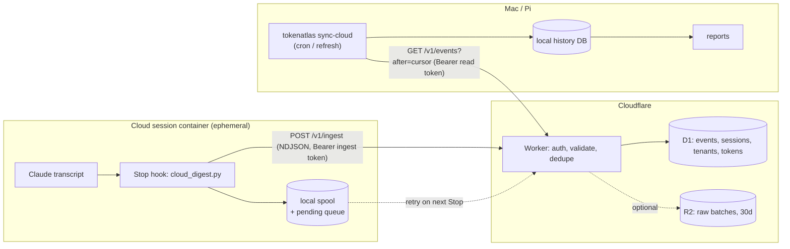

# Cloud ingest: an always-on destination for cloud-session usage (design)

Status: proposal, no implementation. Builds on `docs/cloud-sessions.md` (TOKEN-200/201): `scripts/cloud_digest.py` already
reduces a cloud transcript to a text-free digest and can POST it as NDJSON with a bearer token. This document decides
*where that POST lands* and how local TokenAtlas pulls it back.

## 1. Problem and decision

Cloud sessions run in containers that are reclaimed, so their usage must leave the container while it is alive. The
destination has to be reachable from the container at any time. A laptop or a Pi behind a tunnel is not (asleep, offline,
tunnel down). A git repo works as a mailbox but is a poor fit: it needs a write credential with repo scope inside a
container an agent controls, every Stop becomes a commit, concurrent sessions race on pushes, there is no per-row
idempotency or schema validation, and history is permanent (a problem for deletion requests).

**Decision: a small HTTP ingest API on Cloudflare (Worker + D1, optionally R2), pulled by local TokenAtlas.** The API contract
is plain HTTP + JSON/NDJSON and the storage is plain SQL, so the same contract can later run on AWS (section 11). The
design is multi-tenant-ready from day one, because it may become a service; today there is one tenant.

Non-goals: no dashboards in the cloud (reports stay local), no prompt/response text ever stored, no real-time streaming.

## 2. Data flow



1. Stop hook digests new transcript lines (already built) and POSTs them. Failure leaves them in the pending queue.
2. The Worker authenticates, validates every row against the schema, inserts with `INSERT OR IGNORE` on the dedupe key and
   answers with per-batch counts. It is stateless; D1 is the only state.
3. Local TokenAtlas pulls rows after its cursor and feeds them to the existing Claude collector as a `cloud` root (digest
   rows are the Claude JSONL shape), so `requestId` dedupe, pricing, projects and reports work unchanged.

## 3. API (vendor-neutral, versioned in the path)

All bodies are UTF-8. Errors are `{"error": {"code": "...", "message": "..."}}` with standard status codes. `v1` is additive only; breaking changes get a new path prefix. Every response carries `X-TokenAtlas-Api: 1`.

| Endpoint | Auth scope | Purpose |
| --- | --- | --- |
| `POST /v1/ingest` | `ingest` | NDJSON, one digest row per line, max 200 rows / 256 KB per request (raise after measuring Worker CPU). Returns `{accepted, duplicates, rejected:[{line,code}]}`. Partial success is normal: 200 if the request was well-formed, 4xx only for the whole request (auth, size, content type) |
| `GET /v1/events?after=<cursor>&limit=1000` | `read` | NDJSON page in ingest order plus `X-Next-Cursor`. Cursor is opaque (an encoded monotonic `seq`) |
| `GET /v1/health` | none | `{ok, api:1}`; no tenant data |

Token minting/revoking and erasure are **not** HTTP endpoints in v1: they are an operator script (`wrangler d1 execute`
behind a small CLI), which keeps the attack surface to two scopes (`ingest`, `read`). Add an `admin` API only when other
tenants exist.

Rules: HTTPS only, no redirects honoured by the client (already enforced in `cloud_digest.py`), 
`Idempotency` comes from row keys (section 6) so clients may retry blindly, `429` carries `Retry-After`.

## 4. Auth and tenancy

- **Tenant** = an account (today: Magnus). Every table has `tenant_id`; every query is scoped by it, taken from the token,
  never from the request body or URL.
- **Tokens** are random 256-bit secrets, format `tka_<scope>_<id>_<secret>`. D1 stores only `sha256(secret)`, scope, tenant,
  label, `created_at`, `last_used_at`, `revoked_at`. Scopes: `ingest` (write only) and `read` (pull only).
- **The cloud container only ever gets an `ingest` token.** Environment secrets in a cloud session are readable by the
  agent and anything it runs, so assume the token leaks: it can add rows for that tenant but cannot read or delete. Mitigate
  with per-environment tokens (revoke one without touching others), per-token daily row quotas, and strict field validation (section 5) so a leaked token cannot smuggle free text or paths. Rows from a token carry `token_id` for forensics and bulk
  removal.
- The `read` token lives on the Mac/Pi only, in the OS keychain or a 0600 file.
- A leaked ingest token can still **forge plausible counters** for that tenant; validation limits what a row can carry, not
  whether numbers are true. Pulled events keep `token_id` and `seq` locally. A purge removes the raw rows; it does **not** lower already imported totals (history keeps the maximum per counter and keeps observations), so reversing a forged import needs per-event provenance and a rebuild from surviving events (not in v1; the claim is limited to raw rows).
- Free-tier quotas are account-wide: one leaked token can exhaust the daily limits for everyone. Put a Cloudflare
  rate-limiting rule in front of the Worker (rejected and unauthenticated requests still count) plus per-token daily caps enforced by the atomic `quota_day` counter. Cloudflare's free rate limiting is per IP over a short window and can lag, so treat it as mitigation only; authenticated budgets are enforced in the Worker.
- Later for a real service: sign-up flow, OAuth/OIDC for humans, per-tenant limits. Not needed for v1; the schema allows it.

## 5. D1 schema (portable SQL: SQLite dialect, also valid Postgres with trivial type changes)

```sql
CREATE TABLE tenants (
  tenant_id   TEXT PRIMARY KEY,          -- ulid
  name        TEXT NOT NULL,
  created_at  TEXT NOT NULL,
  retention_days INTEGER NOT NULL DEFAULT 90
);
CREATE TABLE tokens (
  token_id    TEXT PRIMARY KEY,
  tenant_id   TEXT NOT NULL REFERENCES tenants(tenant_id),
  secret_sha256 TEXT NOT NULL UNIQUE,
  scope       TEXT NOT NULL CHECK (scope IN ('ingest','read')),
  label       TEXT NOT NULL,
  created_at  TEXT NOT NULL, last_used_at TEXT, revoked_at TEXT
);
CREATE TABLE events (
  seq         INTEGER PRIMARY KEY AUTOINCREMENT,   -- cursor for pull, ingest order
  tenant_id   TEXT NOT NULL,
    dedupe_key  TEXT NOT NULL,                       -- see section 6
  source      TEXT NOT NULL,                       -- token's source namespace (environment label)
  session_id  TEXT NOT NULL,                       -- enclosing session dir, hook grammar, no dots
  rel_path    TEXT NOT NULL DEFAULT '',            -- hook's `_path`: '' (main) or a subagent path, validated
  line_id     TEXT NOT NULL,                       -- uuid, else sha256 of the canonical row
  request_id  TEXT,
  ts          TEXT NOT NULL,                       -- event time from the row
  received_at TEXT NOT NULL,
  token_id    TEXT NOT NULL,
  schema_ver  INTEGER NOT NULL DEFAULT 1,
  row_json    TEXT NOT NULL,                       -- the validated digest row, no text
  UNIQUE (tenant_id, dedupe_key)
);
CREATE INDEX events_pull ON events (tenant_id, seq);
CREATE INDEX events_session ON events (tenant_id, session_id);
CREATE INDEX events_retention ON events (tenant_id, received_at);   -- chunked retention deletes
CREATE TABLE quota_day (token_id TEXT, day TEXT, rows INTEGER NOT NULL DEFAULT 0, PRIMARY KEY (token_id, day));  -- atomic daily counter, no scans
CREATE TABLE tombstones (tenant_id TEXT, dedupe_key TEXT, deleted_at TEXT, PRIMARY KEY (tenant_id, dedupe_key));  -- erased keys, kept for the replay window
CREATE TABLE tenant_state (tenant_id TEXT PRIMARY KEY, generation INTEGER NOT NULL DEFAULT 1, deleted_through_seq INTEGER NOT NULL DEFAULT 0);
```

`row_json` keeps the digest rows (new counters need no migration).

**Wire row.** One NDJSON line is a digest row exactly as `cloud_digest.py` writes it, plus `_path` (what the hook sends for
subagent files) and the enclosing `session` id, which the client must send because a subagent row has no usable
`sessionId` of its own. The Worker maps them to `session_id` and `rel_path`. Round-trip tests must include a subagent row
without `sessionId` and the workflow subagent layout.

**Validation, server-side, per field:**
- `session` and ids (`uuid`, `requestId`, `message.id`, `agentId`) use the hook's narrow grammar `[A-Za-z0-9][A-Za-z0-9_-]{0,63}`
  (no `.`, no `..`, no separators); `model`/`version`/`effort` short tight patterns.
- `_path` matches `^(subagents/(workflows/wf_[A-Za-z0-9_-]+/)?agent-[A-Za-z0-9_-]+\.jsonl)?$` (workflow subagents included;
  the hook's file discovery must queue them too).
- `usage`: the nested allowlist the hook emits (`cache_creation.ephemeral_{5m,1h}_input_tokens`, `output_tokens_details`,
  `iterations[]`, labels such as `speed`), not just flat integers; dropping `speed` would change pricing, so a
  POST/GET round trip must keep pricing identical. Counters are integers in `[0, 2^53-1]` (exact in JS and SQLite int64),
  also nested; `iterations` has a length cap.
- Per-row cap 16 KB; a larger row is rejected with `row_too_large` (the client quarantines it, section 7).
- `cwd` and `gitBranch`: at most 256 printable characters. **This is not content-free**: a leaked ingest token can put
  arbitrary short text there. The real guarantee is "an honest hook sends no content, and the server bounds what a dishonest
  sender can store". Service tenants may choose to hash or drop them (section 14). Nothing is archived unvalidated.
- **Unknown keys are stripped, not rejected** (a newer hook against an older Worker must not lose usage). A row failing a
  known field is rejected with a per-line code.

The puller treats pulled rows as untrusted, revalidates `session_id`/`rel_path` with the same grammar, and resolves the final
path to check it is under the tenant's spool root before writing. Reports escape `cwd`/`gitBranch`. Insert as one
`INSERT ... SELECT ... FROM json_each(?)` per batch (D1 limits queries per invocation and bound parameters per statement).

## 6. Idempotency and dedupe

- Transcripts write several assistant rows per `requestId` (one per content block), and earlier rows can carry partial
  `output_tokens`. So the ingest layer must **not** collapse by `requestId`: first-wins would keep a partial row and
  undercount. `dedupe_key = sha256(tenant | source | session_id | rel_path | line_id)`, where `line_id` is the line's `uuid`, or for a row without one a hash of the canonical row. The Worker computes it and binds it to the token's `source` namespace, so one environment cannot claim another's keys. The same key with different content is a conflict: keep the first, count it in `conflicts` and surface it in the receipt.
  Collapsing per `requestId` stays the **local collector's** job, exactly as for local transcripts. Its rule is the per-field maximum of each counter (`why.py`), not "last row wins": a later correction that lowers a counter will not lower the total, and a recompute is needed for that.
- Erased rows leave a tombstone for the replay window so a queued retry or transcript reread cannot resurrect them with a fresh retention.
- Never upsert in place: an updated row would keep its old `seq` and pullers already past it would never see it.
- `INSERT ... ON CONFLICT DO NOTHING` on `UNIQUE(tenant_id, dedupe_key)`: a retry, a resend after a lost response, or two overlapping Stops
  all converge. A row with the same `uuid` is by definition the same line; a rewritten transcript with new uuids simply adds rows, which the local `requestId` rule collapses.
- The client does not need the response to be exact: 2xx means "queued rows may be dropped", anything else means "keep".
- Local import dedupes again by `requestId`, so pulling the same range twice is harmless.

## 7. Client: spool, retry, backoff

`cloud_digest.py` already has the pieces: byte-offset per transcript, local spool mirroring the transcript layout, a
`pending.jsonl` queue, 3 s timeout, exit 0 always. Changes for this design:

- Send to `/v1/ingest` with the `ingest` token; batch up to the API limits (several Stops' worth if the queue is long).
- **Per-line receipts, not whole-batch 2xx.** A 200 carries `results: [{line, status: accepted|duplicate|conflict|rejected, code}]`.
  The client removes accepted and duplicate lines, moves permanent rejects (`rejected`, `row_too_large`) to a local
  quarantine file with a counted drop, and keeps the batch if the receipt is missing or incomplete (today's hook clears the
  sent bytes on any 2xx, which would lose rejected rows). A single oversized row is quarantined by a client-side size check
  before sending, so one bad line cannot block the FIFO queue. On 5xx/429/timeout keep and retry at the next Stop. Honour `Retry-After` by skipping sends
  until then (store the deadline in the state dir). On 401/403 stop sending and write a one-line warning to the spool dir
  (the token is dead; do not spin). On 413 halve the batch.
- **The last turn is lost systematically, not rarely**: the transcript can lag the Stop hook (`cloud-sessions.md`), so the
  final turn's usage would arrive "one Stop late", which for the last Stop is never. Add a short catch-up wait in the hook
  (inside its 5 s budget; with a 3 s POST timeout only one POST fits per Stop), and flush on `SessionStart` (resumed
  containers) and `SessionEnd` if the harness fires them in cloud sessions (to verify in slice 0).
- Client changes this implies: `_post` must return status and `Retry-After` (it returns a bool today), and must cap each send
  to the API limits (it sends the whole pending file today).
- Container reclaimed with rows still queued = lost. That is an accepted, measurable loss: log `queued_at_exit` locally,
  and add a coverage check (section 8). `queued_at_exit` dies with the container and an idle tail looks like a lost one, so completeness cannot be proven from the client alone: until an independent session-end or expected-count watermark exists (slice 0 checks what the harness offers), report last-seen time per session and mark completeness *unknown* rather than complete.
- No SDK, no dependencies: stdlib `urllib`, as now.

## 8. Pull / sync model

`tokenatlas sync-cloud` (also run inside `refresh --all`):

1. Read `cursor` from the local DB (`meta` key per source id, e.g. `cloud:<tenant>`).
2. `GET /v1/events?after=<cursor>&limit=...` (page capped by rows and bytes, below D1's per-query result limit) until a page is empty. Store each pulled event once in a local table keyed `(source, tenant, seq)` and commit the page and the new cursor in **one transaction**. Then build the `cloud` root JSONL (one per session and subagent path, the layout the Claude collector reads) from the stored events in stable `seq` order and call the normal collect/import. Replaying a page therefore cannot move a request between turns (the collector assigns turns by file order).
3. Pull is at-least-once, the local event table makes it exactly-once. Cursor loss means a full re-pull from the table's keys.
4. Pi and Mac each hold their own cursor, so both converge on the same rows; the existing snapshot/`remote_sync.sh` merge
   rules (machine id on each observation) then treat cloud rows as one more source, not as a machine: cloud observations carry a stable shared origin id instead of the local machine id (otherwise Mac and Pi count the same row twice), and cloud `cwd` values are never used for local filesystem discovery. Slice 0 verifies this.
5. Show a freshness line in reports: "cloud: last event 12 min ago, N sessions, pulled 3 min ago", and flag a gap when
   the list of cloud sessions is known to be longer than the ingested session count.

`seq` on D1 is safe because D1 has a single serialized writer. On Postgres, identity values are not commit-ordered, so the
same cursor can skip rows under concurrent writers (and `(received_at, id)` has the same flaw): the AWS port must take a per-tenant lock before allocating the sequence and hold it through commit (a fixed lag does not help against a long-open transaction), or define a watermark that proves no lower sequence can still commit. The cursor is opaque and encodes `(tenant, generation, seq)`; `seq` is per tenant once there are other tenants (a global one leaks cross-tenant volume). A reply to a cursor older than `deleted_through_seq` or from an older `generation` (restore, migration) is an explicit `410 cursor_expired`/`reset` rather than an empty page, so "caught up" and "rows expired" are distinguishable. A puller
offline longer than `retention_days` silently misses rows: warn when the cursor is older than retention.

## 9. Privacy and GDPR

- **Data minimisation is the design**: digest rows contain token counters, model, timestamps, session/request ids, `cwd`,
  git branch and version. No prompts, no tool output, no file content. `cwd` and branch can still reveal project names:
  treat them as personal data and document it; offer a client option to hash or drop `cwd`/`gitBranch` for service users.
- Roles: for Magnus's own use this is personal data of one person (the household exemption applies only if the sessions are purely personal; work data makes him a controller with Cloudflare as processor). If offered as a service, TokenAtlas becomes a processor for
  customers: needs a DPA, a sub-processor list (Cloudflare), a privacy notice and a record of processing. Cloudflare's
  GDPR/DPA terms apply; prefer D1's EU jurisdiction restriction (set at creation, not changeable; verify) over a mere location hint. A Worker runs at the edge nearest the caller and callers are likely US-hosted containers, so transit and processing are not EU-only; say so in the notice. Usage data per person in an employer context is employee monitoring, which matters for the service case.
- **Retention**: `retention_days` per tenant (default 90), enforced on `received_at` (not event `ts`: a transcript restart resends old rows) by a daily scheduled Worker. Local
  copies are unaffected, which is the intended long-term store.
- **Erasure/export**: operator script by session, token or date; `GET /v1/events` is also the export. Erasure is not absolute: D1 Time Travel keeps deleted data restorable for a limited window, and local copies and snapshots on the Mac/Pi are untouched. Say so in the notice. Deleting also writes tombstones (section 6) and covers any R2 copy.
- Tokens are stored hashed (update `last_used_at` at most hourly, to save writes); logs never contain bodies or tokens.
- R2 raw payloads (if used) store only validated, re-serialized rows, get the same retention and are off by default: they add no value while the digest is the
  contract, and they enlarge the personal-data surface.

## 10. Cost (free tier; verify current limits before building, they change)

Assumed load for one user: ~100 Stops/day; the measured digest was 151 KB for 72 requests, i.e. about 2 KB per request including all content-block rows, so budget ~2 KB/row plus index overhead.

| Item | Free-tier headroom (as of this writing) | This workload |
| --- | --- | --- |
| Workers requests | 100,000/day | ~100-300/day ingest + a few pulls |
| Workers CPU | ~10 ms per request on free | Validation of 500 rows is within reach but should be measured; paid plan raises it |
| D1 rows written | 100,000/day | a few thousand rows/day; each row costs ~4 writes (table, UNIQUE index, two indexes), retention deletes count too |
| D1 rows read | 5,000,000/day | pulls are index scans on `(tenant_id, seq)`: tiny |
| D1 storage | 5 GB per account, but I believe 500 MB per database on free | a few MB/day; 90-day retention may approach the per-database cap, so measure and shorten retention if needed |
| R2 (optional) | 10 GB, no egress fees | unused by default |

So: **0 SEK/month for Magnus alone.** The paid Workers plan is about 5 USD/month and covers the first real multi-tenant
step. A service with 1,000 users at this load is millions of rows/day, i.e. ~10M+ row-writes/day with indexes; at paid D1 write rates that is on the order of 250 USD/month for writes alone (batching does not reduce the per-row charge), against a 10 GB hard per-database limit, so a real service needs batching, fewer indexes or a different store. Quotas are account-wide on free, so one noisy token affects everyone. A custom
domain is optional but recommended (section 11), and a domain costs more than the infrastructure.

Reliability, honestly: Cloudflare is far more available than any home machine, but "always on" is a property of the whole
path. The Worker can be down, the container's network policy can block the hostname, and the container can die before the
last flush. The spool/retry plus a coverage check turn silent loss into a visible gap.

## 11. Vendor neutrality and the AWS path

Keep the Cloudflare-specific part thin (DDL is per-dialect: `AUTOINCREMENT` is SQLite, Postgres uses identity columns; the contract tests, not the DDL, are the portable part):

- The contract is the HTTP API and the SQL schema above. Business logic (auth, validation, dedupe, cursor) lives in a
  plain TypeScript module with ports `Db` (SQL) and `Clock`; only the entrypoint (`fetch` handler, D1 binding) is
  Cloudflare. Same module runs behind Lambda/API Gateway with Postgres or Aurora, or in a container.
- **Use a custom domain from day one** (`ingest.<domain>`, not `*.workers.dev`), so clients, hook configs and tokens survive a
  provider move by changing DNS only.
- Avoid Cloudflare-only features in the data path (Durable Objects, Queues, KV for authoritative state). Rate limiting is
  best-effort and replaceable.
- Migrations are numbered `.sql` files with a per-dialect directory; queries stick to the common subset (`ON CONFLICT DO NOTHING`).
- Contract tests (a script that posts fixture batches and checks results) run against any deployment, so a move is "pass the
  same suite". Export is `GET /v1/events` into the new backend, but it carries no auth state: a cutover must also migrate token hashes, scopes and revocations and the sequence high-water mark, or issue a cursor reset (`generation` bump) so clients re-pull.
- Is AWS more robust? Marginally for raw uptime, at much higher setup, IAM and ongoing cost (API Gateway, Lambda, RDS/DynamoDB
  minimums, NAT/logging) and a bigger ops surface. Both depend on the same weak links (client retries, container network).
  Recommendation: Cloudflare now; revisit AWS only if a customer needs it (compliance, region, enterprise procurement) or
  D1 limits bind.
- Alternative considered: Claude Code's native OpenTelemetry export. It needs no hook, but probably lacks per-request rows and is untested in cloud sessions; worth a check in slice 0.

## 12. Migration from the git approach

There is no git-based pipeline in production yet (the digest ships to a local spool and optionally an HTTPS URL; git was one
of the sink candidates). So migration is mostly "don't build it":

1. Build the Worker and `sync-cloud` behind the existing `TOKENATLAS_CLOUD_URL` contract (the hook already speaks it).
2. If any digest was committed to a repo in the meantime, add a one-off `tokenatlas import-spool <dir>` that reads those
   JSONL files into the same `cloud` root; dedupe by `requestId` makes it safe to run alongside live ingest.
3. Roll out the hook to one repo, compare session counts for a week (coverage check), then enable it everywhere and remove
   any git-writing credentials from cloud environments.

## 13. Rollout slices (candidate tickets)

0. **Blockers first**, with a throwaway `workers.dev` echo endpoint before any Worker code, probed with the production client's headers and a descriptive User-Agent (Python urllib's default UA can be blocked by Browser Integrity Check and look like a network denial): does a committed Stop hook fire in a fresh cloud session, can it read an environment secret, is the hostname allowed by the network policy, do `SessionStart`/`SessionEnd` fire, and does a pull of the same rows on Pi and Mac merge to one in the snapshot/`remote_sync.sh` path.
1. Contract tests and the portable core module (validation, dedupe key, cursor) with fixtures from real digests.
2. Worker + D1 migrations + token admin CLI; deploy to a custom domain.
3. Hook update: batching to API limits, status-aware backoff, dead-token handling, catch-up wait and extra flushes.
4. `tokenatlas sync-cloud`, cursor storage, cloud freshness line in reports.
5. Retention job (chunked deletes on `(tenant_id, received_at)`), operator erasure script as the deliverable (no HTTP admin endpoint), privacy notice text.
6. Per-session coverage check (last ingested `ts` vs session end).

Behaviour when the daily quota is exhausted: ingest returns 429/5xx, clients keep the queue, loss depends on the container surviving; the rate-limit rule in front keeps junk traffic from causing this.

## 14. Open questions

- Does the environment's network policy allow a custom Cloudflare hostname by default? (blocks the whole plan if not; test first)
- Can a repo-level Stop hook read an environment secret in a fresh cloud session?
- `cwd`/branch: keep, hash or drop by default for non-owner tenants?
- Is the product a hosted service or a self-host template (`wrangler deploy` for your own account)? The self-host route
  removes the processor/DPA burden and fits the vendor-neutral contract; recommended as the first "product" step.
